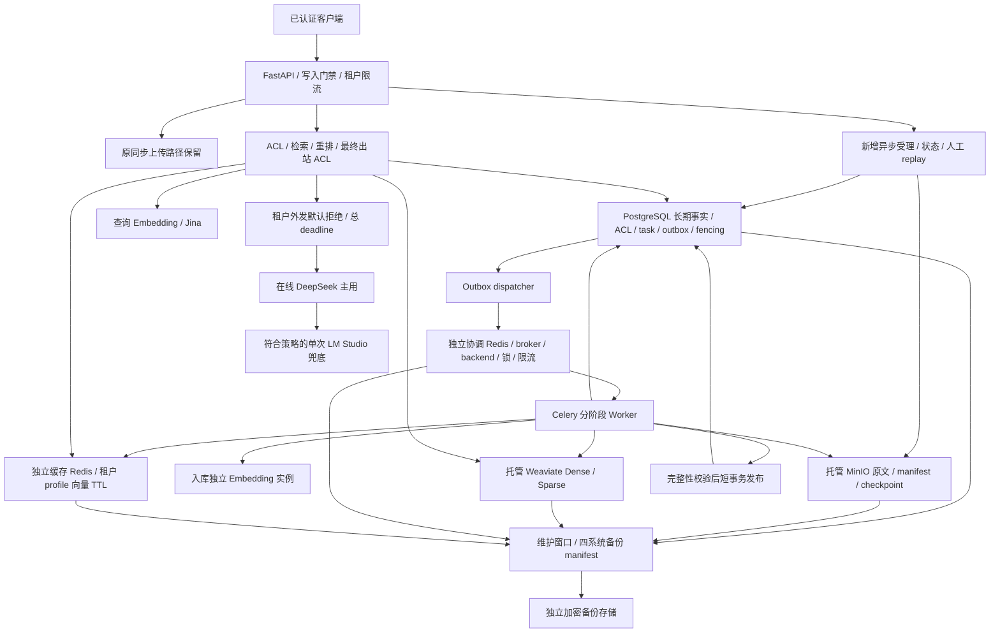

# Redis、异步摄取与备份恢复演进

## 状态与决策

2026-10-06：用户已批准推荐方案。本文区分设计、实现和验收，不替代运行证据。

| 类别 | 当前范围 |
|---|---|
| 已确认 | 单机 Docker Compose；托管 MinIO、Weaviate、DeepSeek；Redis/Celery/PostgreSQL 自建 |
| 已确认 | Celery 使用 Redis broker/backend，不增加 RabbitMQ；缓存与协调使用独立实例，不只是不同 DB |
| 已实现 | 独立配置、Redis 缓存/锁/限流原语、缓存 Embedding wrapper、MinIO adapter、Celery 配置工厂 |
| 已实现 | 显式 0005 任务/stage/outbox 表、TaskLedger、有限重试/死信/replay、租约/fencing/checkpoint、投递/恢复原语 |
| 已验证 | 新基础组件/账本 59 项、含旧 migration 定向 70 项；离线全量 437 passed/12 skipped；局部静态检查通过 |
| 待实现 | 真实阶段 Worker、异步 API、原文迁移、写入门禁、备份/恢复 CLI、DeepSeek 路由、生产装配 |
| 待实验 | 托管服务契约、50 QPS、并行入库、真实故障、跨系统备份与恢复 RPO/RTO |
| 阻塞点 | 托管版本/规格/权限/endpoint 未提供，DeepSeek endpoint/key/model 留空，生产身份未装配 |
| 非目标 | 主机级 HA、Kubernetes、OCR、Agentic、大模型下载、RabbitMQ 和无证据纯模型兜底 |

旧同步 `POST /api/v1/documents` 的路径、返回状态、身份和模型 profile 不变。
新增基础设施默认关闭；现有 factory **尚未接入** `InfrastructureSettings`。
打开模板开关本身不启用异步业务。旧 `.env` 和运行中的服务未在本阶段修改。

## 目标架构

下图是完成全部阶段后的目标，不是当前已装配的运行拓扑。

Redis 锁不是发布事实源；即使租约过期、Worker 卡顿或消息重复，旧 fencing token
也必须在 PostgreSQL 条件更新中失效。Celery 至少一次投递，不承诺 exactly-once。
两种 Embedding 使用同一不可变模型/profile/维度，但使用独立资源，不能凭名称认定等价。

## 阶段与验证

| 阶段 | 实现内容 | 通过标准 |
|---|---|---|
| 1 | 配置、缓存/锁/限流、MinIO adapter、Celery 配置 | 默认关闭、脱敏、租户/profile 隔离、取消传播、TTL、SDK 清理、旧 API 离线回归 |
| 2 | additive migration、task/stage/outbox、fencing、异步 API、Worker、恢复调度 | 提交后 broker 故障不丢任务；重复投递、kill/restart、租约失效、撤权、死信/replay |
| 3 | 原文迁移、全写入门禁、备份 manifest、restore CLI | 对象 hash、PG 引用、双路 generation/pointer 一致；隔离恢复、回滚、失败不开放 |
| 4 | DeepSeek 主用、默认拒绝外发、出站 ACL、单次兜底 | 允许/拒绝租户、timeout、剩余 deadline、撤权、SSE 已输出后禁止混接重试 |
| 5 | Compose、生产入口、监控、真实容量/灾备 | 生产身份可验证，全部真实契约/故障与容量/RPO/RTO 达标 |

### 阶段 1：已有代码

- `src/enterprise_rag/infrastructure/settings.py`：仅读进程环境，敏感字段不进入 repr；
  生产 TLS 校验、独立 Redis endpoint、JSON-only Celery、有限时限和连接池。
- `redis.py`：tenant/profile/精确文本 key，缓存仅保存向量；损坏/不可用按 miss。
  `SET NX PX` 随机 token 锁、Lua compare-and-release/renew、服务端 TIME token bucket。
- `runtime.py`、`celery_app.py`：显式工厂和连接池清理；没有注册任务或发送消息。
- `src/enterprise_rag/storage/s3.py`：兼容 ObjectStorage；path-style、有限 SDK 重试、
  阻塞 SDK 在线程执行，下载流始终关闭；403/5xx 不能当作对象缺失。
- `config/infrastructure.env.example`：配置占位；不会读取或改写现有 `.env`。

安装方案为 Python 3.11 项目专用环境中的 `pip install -e '.[infrastructure,dev]'`。
本阶段没有修改现有 Conda 环境、安装可选 SDK、启动 Worker 或访问托管 endpoint。
因此 SDK 实际兼容性、Redis Lua 原子性、锁续期及限流性能仍待真实测试。
缓存只减少同批/跨批计算；不能替代持久 checkpoint 保证故障恢复不重复 Embedding。
当前 S3 接口仍完整读取 bytes，线程取消不能立即终止 SDK I/O；
流式受理、资源准入和取消后的安全收尾属于后续业务装配，不能宣称已经解决大文件上传阻塞。
缓存 Redis 需使用允许淘汰的策略，协调 Redis 必须 noeviction 且持久化；
endpoint 不同只是配置门禁，实际实例映射、淘汰和持久化策略仍需部署验证。
两个自建实例避免缓存淘汰影响任务，但共享单机不具备主机级故障域隔离。

### 阶段 2：事务与消息边界

已实现生命周期基础 `db/async_ingestion.py` 与 `ingestion/task_ledger.py`，
包括显式 0005 additive migration（默认仍为 0004）、受理事实同事务、
租户/所有者可见性、有限重试、死信 replay、租约/fence/checkpoint 和 outbox 恢复原语。
这些仍未接入 HTTP/Celery；没有实际解析/Embedding/索引/发布，不能当作完整异步入库。
当前手工 replay 保留旧执行但不复用跨执行 checkpoint；
业务层还需验证 hash/profile/授权和安全复用条件。

建议新增入口 `POST /api/v1/ingestion/tasks` 返回 202，
`GET /api/v1/ingestion/tasks/{task_id}` 和
`POST /api/v1/ingestion/tasks/{task_id}/replay`；这些入口**尚未实现**。

1. 可信身份与角色校验、有限上传准入，流式写原文并计算 hash；不先执行解析/Embedding。
2. 一次短 PG 事务写任务和 outbox。对象已写而事务失败时留下不可见孤儿，后续审计回收。
3. dispatcher 用有限租约领取 outbox；只有 broker 接受后标记送达。发送与提交间崩溃
   可重复投递，由消费者用 task/stage/fence 幂等处理，不依赖 result backend。
4. 阶段划分为 parse/chunk、Embedding 批次、Dense、Sparse、verify、publish。
   外部调用移出长期数据库事务，每次成功后按 tenant/profile/hash 提交 checkpoint。
5. PostgreSQL 原子领取任务并增加 fence；更新 checkpoint、失败和发布均核对
   tenant/task/stage/fence/lease。过期 Worker 不得发布，也不能覆盖后来者的状态。
6. Worker 从 PG 重新加载上下文并复核角色/文档状态；消息只含 opaque task ID，
   不含 token、正文、endpoint 或 API key。共享队列的逻辑隔离不等于租户资源公平。
7. 暂时性错误每阶段额外最多重试 3 次，退避+jitter；输入/授权/维度错误不自动重试。
   重试调度事实保存在 PG；Celery retry 不是唯一恢复依据。
   Worker lost/重复 redelivery 的领取尝试也须计入持久预算，禁止毒消息无限重启。
8. 超限进入 PG 终态死信；人工 replay 写新的执行记录和审计，保留旧失败记录。
   broker/result 丢失后由 reconciler 从 PG 恢复；旧 result key 不能覆盖新执行事实。

禁止简单把旧 `upload()` 包一层 Celery：旧 Dense build 仍有事务内外部调用，
这样的包装无法提供分阶段重试、持久 Embedding checkpoint 或 fencing。

## 备份与恢复设计

**备份/恢复 CLI 尚未实现，不得按本文宣称已演练。**
托管 Weaviate backup API/module、MinIO 版本化与导出权限需提供商确认；
自建 Redis 的 snapshot/AOF 策略与导出能力需在独立环境验证。
若无法取得一致快照，必须明确降低目标或更换支持能力的方案。

### 一致备份

每日 02:00，30 分钟维护窗口；超时即失败并告警，不把部分备份标为成功。
全局写入门禁必须覆盖同步/异步上传、ACL、撤权/删除、replay、publish、cleanup、
迁移和全部后台任务；只暂停 Worker 或发布不构成一致备份。

1. 拒绝新业务写入，暂停 dispatcher/reconciler/调度，等待在途任务和写事务结束。
   无法确认无在途写入则备份失败；不能在仍可能写外部索引时继续拍快照。
2. 门禁保持期间执行 PG 一致 dump、Weaviate 所需 Dense/Sparse 全部 collection backup、
   MinIO 对象及必要版本导出、两个 Redis snapshot。PG 中保存完整 outbox 和任务事实。
3. manifest 记录 backup ID、组件版本/schema/profile、开始结束时间、快照 ID、
   object/generation/pointer 计数、checksum、加密/密钥引用和门禁证据，不保存密钥本身。
4. 所有组件完成并校验后才提交 completed manifest 至独立加密备份存储。
   清理/保留只处理 completed 集，不删除最后一个可恢复版本。
5. 解除门禁前核对状态；失败恢复流程亦需明确告警，不默默恢复错误版本。

目标 RPO 24 小时；日备份 7 份、周 4 份、月 12 份。独立存储不可与主 bucket 共故障域；
共享主机磁盘副本不是独立备份。加密与恢复密钥必须另行备份并做权限控制。

### 隔离恢复

1. 使用新环境/独立 bucket 和 collection/新 Redis namespace，保持写入与生成关闭。
   校验 manifest 完整性、checksum、schema/profile、解密权限与空间；不覆盖线上环境。
2. 恢复 PG、MinIO、Weaviate，在隔离环境验证原文/manifest hash、lineage、ACL、
   双路对象计数、维度、generation/active pointer，失败不开放完整查询。
3. Redis snapshot 留作恢复证据，但**不得直接沿用旧锁、限流租约或执行旧 broker 消息**。
   缓存可选择冷启动；任务/result 状态以 PG 为准，恢复后旋转 namespace，
   将旧 lease/fence 作废，通过 reconciler 重建待处理任务。
4. 状态服务 1 小时内开放；全检索/回答 4 小时内开放；入库 8 小时内开放。
   入库开放前完成 fencing 失效、任务去重、权限复核和并发写入 smoke。
5. 每月隔离演练及每次 schema/索引格式变化后的恢复演练，记录真实耗时、
   最大数据损失、失败原因、跨租户测试和人工核对，不仅检查命令退出码。

上述时间均是已批准的**待实验目标**，不是承诺现有机器已达标。
未来 CLI 应支持 plan/backup/verify/restore，restore 必须显式指定目标、
确认隔离环境、恢复阶段和 completed manifest；默认不执行破坏性覆盖。

## DeepSeek 与安全

endpoint、API key、model 留空且默认关闭；启用缺字段拒绝启动，不猜模型名。
租户外发默认拒绝，正文分类与租户政策由可信事实源决定，不能来自自报参数。
拒绝外发的请求只允许按政策走本地路径，不得先尝试把上下文送到在线模型。
符合政策时 DeepSeek 主用，LM Studio 最多兜底一次，共用剩余总 deadline；
SSE 一旦开始输出不得无提示地拼接另一模型答案。
检索失败/无权限/无证据禁止纯模型兜底。正常、失败 message、SSE token、
引用和兜底都必须统一出站 ACL；历史失败 message 风险仍待修复。
正式生产要增加可信 OIDC/网关认证；开发 HMAC/本机匿名不是生产身份实现。

## 迁移与回滚

阶段 1 没有数据库变更，默认行为不变。先部署关闭新能力的代码并跑旧 API 回归，
在独立环境验证可选 SDK/托管服务；随后灰度接入存储和 Worker，不自动搬移旧对象。
原文迁移应逐对象校验 hash、双读核对，成功后更新 locator，旧对象按保留窗口保留。

阶段 2 用 additive migration，不删除/重命名旧表字段。当前 latest 是
`0004_weaviate_hybrid_generations`，显式 `0005_async_ingestion` 已提供但未应用真实库。
当前 CLI 不切换目标；后续装配前在隔离环境调用
`upgrade_database(engine, target_version=ASYNC_INGESTION_VERSION)` 验证。
当前旧代码拒绝未知 schema 版本，因此升级后的数据库不能直接切回旧镜像；
需预先发布识别新 schema 的兼容版本，或通过验证过的备份恢复到隔离旧环境。

回滚先关闭新增受理、暂停调度/Worker并等待安全边界，保留 PG task/outbox/checkpoint。
不得通过清空队列删除任务、删除新表或复用旧 fence“回滚”。
存储回滚只能指向校验过的旧副本；索引用已验证的旧 pointer/profile 回切，
DeepSeek 可禁用并恢复原本地配置，不得绕过授权门禁。

## 测试与监控

- Redis：租户/profile 精确隔离、token 过期/替换、续期失败、真实 Lua 并发限流、
  cache 故障回源、coordination 故障拒绝、TLS、淘汰策略/持久化和 broker redelivery。
- 摄取：任务/消息重复、对象写入后 PG 失败、发布后 ACK 前崩溃、Worker kill、
  checkpoint 复用、取消/撤权、过期 fence、重试超限/人工 replay、积压恢复。
- 对象存储：真实 SDK、权限拒绝、下载关闭、完整 hash、100 MiB 流式上传与资源使用。
- 备份：部分快照/校验/解密失败、窗口超时、无效 manifest、恢复后旧消息、
  不可见半成品、版本不兼容、RPO/RTO、线上环境零改写。
- 模型：外发政策、继承 deadline、一次兜底、取消和 SSE 输出后的安全失败，
  引用、失败 message 与撤权；旧股东问题的引用质量不因新增基础设施自动解决。

采集上传受理/队列等待/各阶段耗时、task 状态/重试/死信、outbox 最老年龄、
lease/fence 冲突、Embedding 回源率与批次、Redis hit/error/eviction/memory、
数据库连接等待、Weaviate 延迟、Provider timeout/兜底、备份年龄/窗口/恢复耗时。
任务 ID/tenant 不作为无界 Prometheus label；日志不记 token、正文或 API key。
告警至少覆盖死信、新任务长期未运行、broker 故障、协调 Redis 淘汰、
备份未 completed 超过 24 小时和恢复校验失败。

容量目标：完整问答 50 QPS 持续 30 分钟，约 4000 输入/最多 512 输出 tokens，
P95 ≤15 秒、成功率 ≥99%，同时入库 100 份/小时，文件样本 1/20/100 MiB。
分别报告 accepted/task succeeded/answered/citation passed，HTTP 200 不等于业务成功。
十万文档需记录实际 chunk 数、平均长度、向量/稀疏体积和租户分布，
托管服务/单机资源未知时不得提前宣称容量可用。
